# Git & GitHub 零基础图文教程

适用：Windows + VS Code + GitHub。本文使用实际仓库 `hqching77/test` 演示。

> **阅读说明**：所有截图均来自本次演示，共 18 张。将 `Git入门教程.md` 与 `images` 文件夹放在一起，图片才能正常显示；建议整个文件夹一起上传 GitHub。截图中尚未出现的 Pull Request 合并与冲突处理，会以文字说明，不伪造截图。

## 0. 一分钟理解 Git

- **Git**：本地版本记录工具。
- **GitHub**：保存和分享 Git 仓库的网站。
- **Repository（仓库）**：一个项目及其版本历史。
- **Branch（分支）**：独立开发路线，`main` 通常是主分支。
- **Stage / Add**：选择下一次提交要保存的修改。
- **Commit**：把选择的修改保存到本地历史，**不会自动上传 GitHub**。
- **Push**：把本地提交上传 GitHub。
- **Pull**：把远程更新带回本地。
- **Pull Request（PR）**：请求把一个分支的改动合并到另一个分支。

**核心流程：Clone → Pull → 修改 → Stage → Commit → Push → PR → Merge。**

## 1. Clone：把 GitHub 项目下载到电脑

1. 在 GitHub 打开仓库，点击绿色 **Code → HTTPS → 复制链接**。

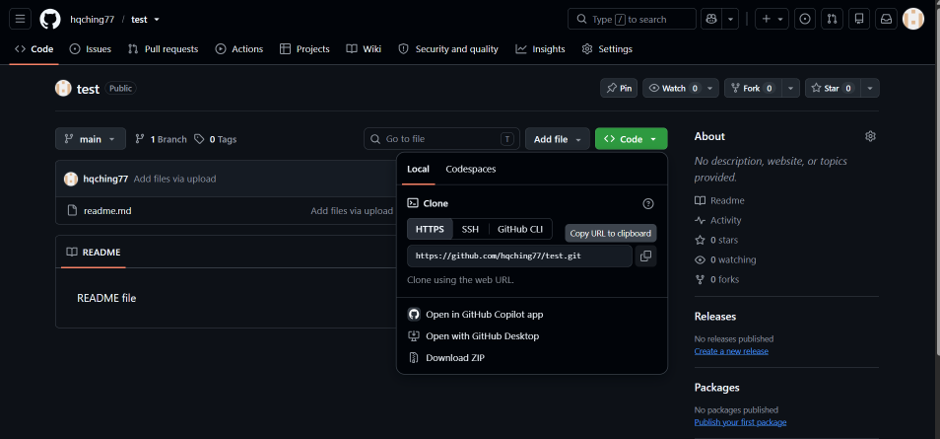

2. 在 Windows 中打开准备存放代码的文件夹，右键空白处选择 **Open in Terminal**。

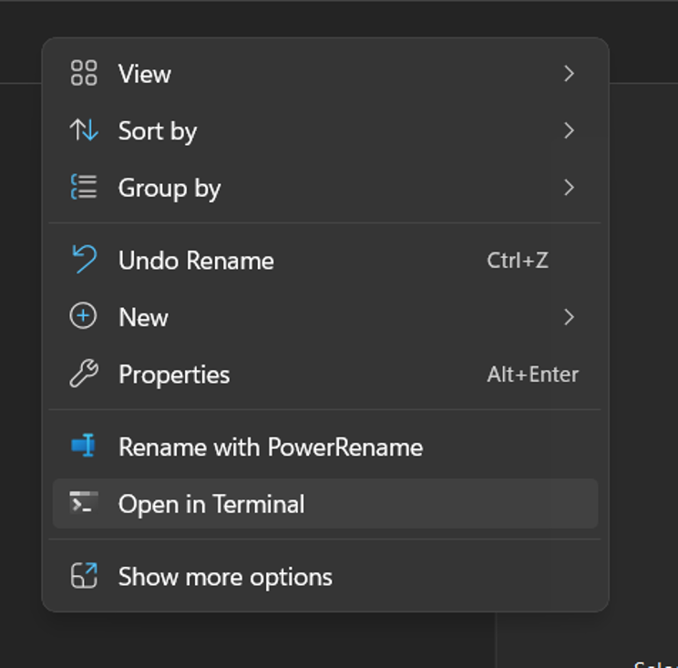

3. 输入：

```powershell
git clone https://github.com/hqching77/test.git
```

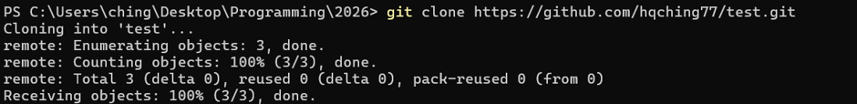

4. 打开刚下载的文件夹：

```powershell
cd test
code .
```

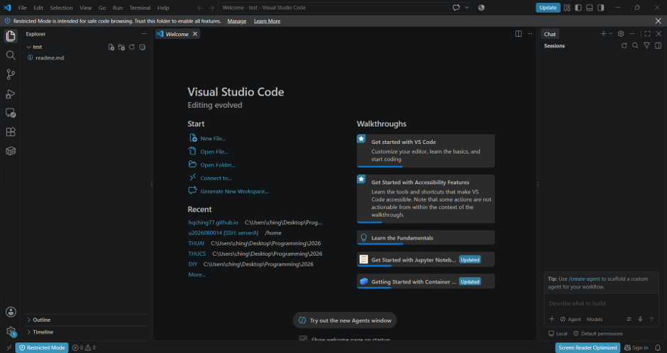

> `git clone` 通常只需要一次。以后进入项目执行 `git pull` 即可同步更新。

## 2. 修改文件 → Stage → Commit

先在 VS Code 中新建 `main.py`，输入：

```python
print("Hello world")
```

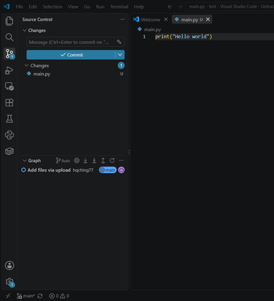

打开左边 **Source Control**（源代码管理）图标。新文件会出现 **U（Untracked）**，表示 Git 尚未跟踪。

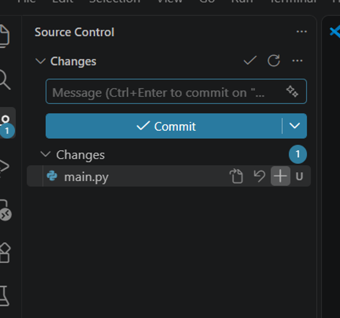

点击文件右边的 `+`，将它加入 **Staged Changes**；在提交消息输入 `Update` 或更清楚的 `Add main.py`，按 **Commit**。

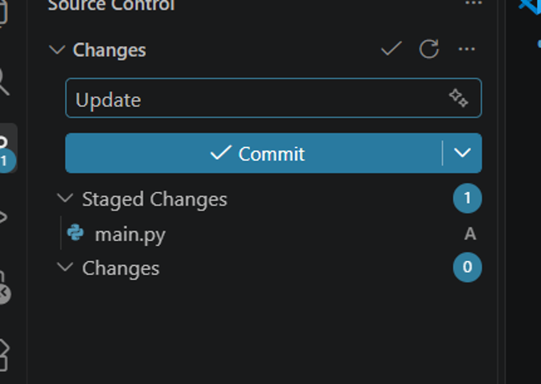

对应终端命令：

```bash
git add main.py
git commit -m "Add main.py"
```

**记住：Commit 只保存到电脑里，GitHub 上还看不到。**

## 3. Push：上传到 GitHub

Commit 后出现 **Sync Changes 1↑**，点击它同步。箭头向上表示有提交等待上传。

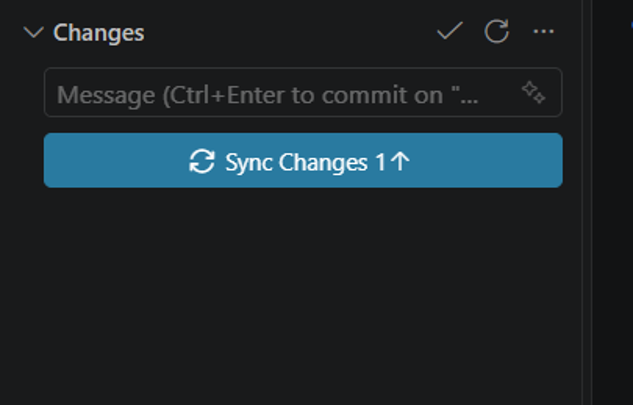

VS Code 会提示将从 `origin/main` 拉取并向其推送，确认后继续。

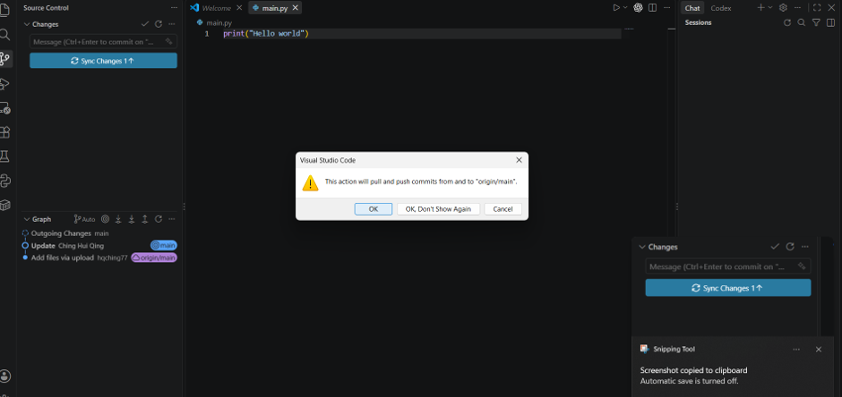

单独使用终端上传可以执行：

```bash
git push
```

GitHub 刷新后，看到 `main.py` 和刚才的 Commit，代表上传成功。

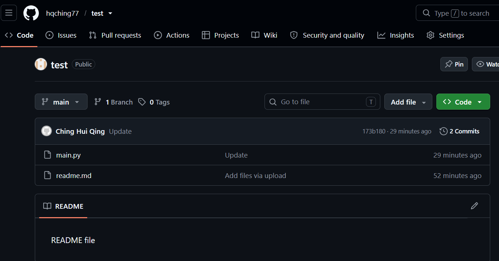

> **Sync Changes ≠ 只有 Push**：它一般会先同步远程更改，再推送本地提交。

## 4. Branch：建立自己的开发分支

多人协作时，不建议所有人直接修改 `main`。先建一个功能分支，例如 `hq-example`。

在 VS Code 的 Source Control 中点击 `... → Branch → Create Branch...`。

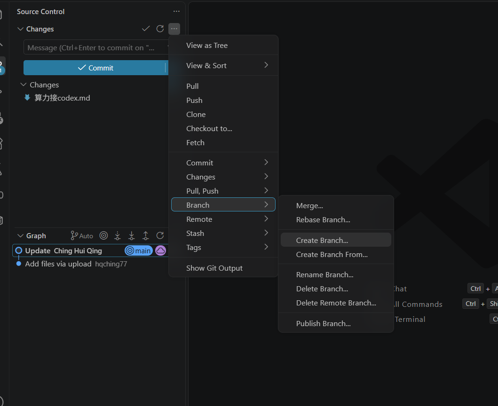

输入分支名称 `hq-example`，按 Enter。

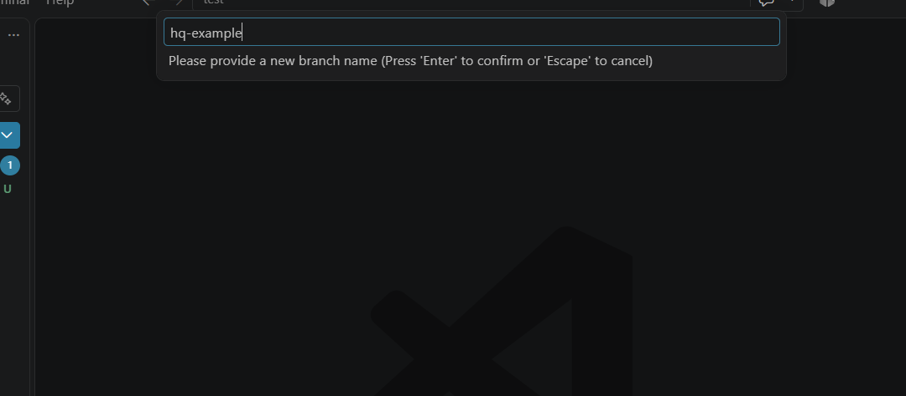

创建后，VS Code 左下角会显示当前分支。可以用分支选择器确认 `main` 和 `hq-example` 的存在。

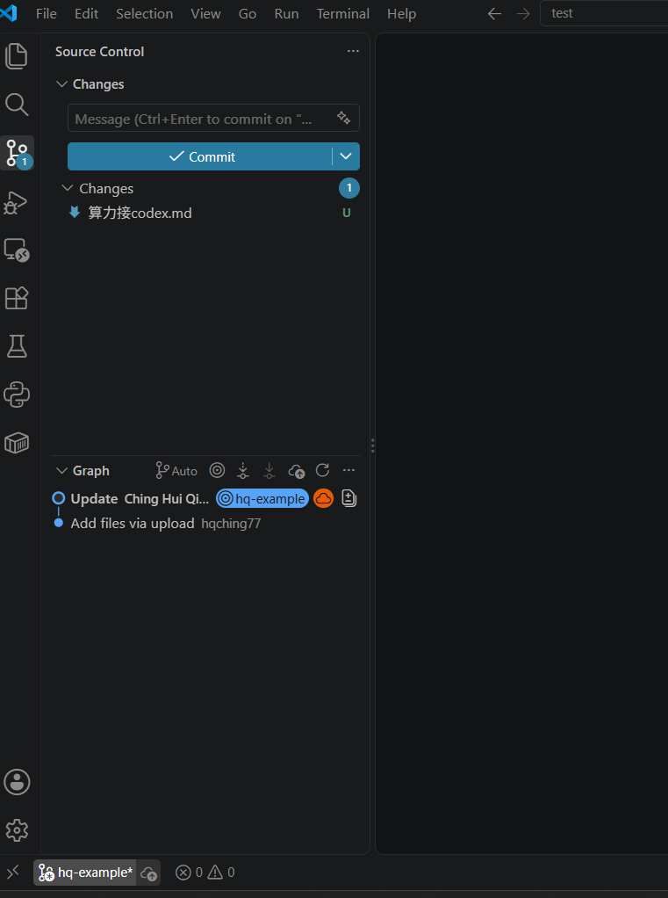

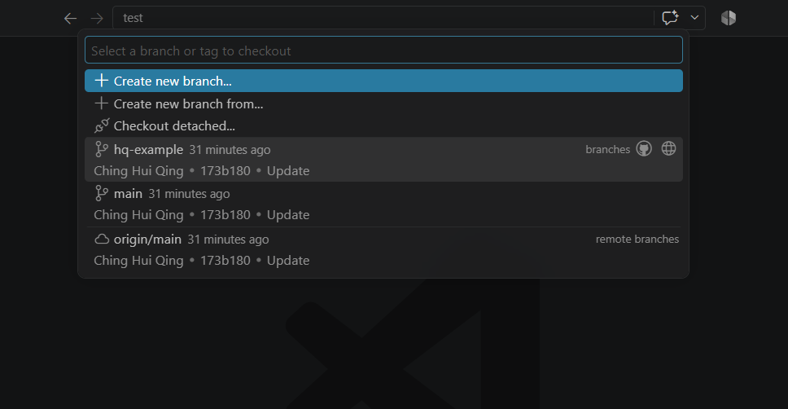

终端等价命令：

```bash
git switch -c hq-example
```

接下来在分支内修改文件，重复 **Stage → Commit**，然后点击 **Publish Branch**。

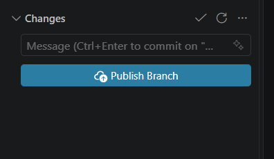

终端等价命令：

```bash
git push -u origin hq-example
```

## 5. 在 GitHub 查看分支、创建 Pull Request

Push / Publish 后，GitHub 可能显示 **Compare & pull request**，点击它发起合并请求。

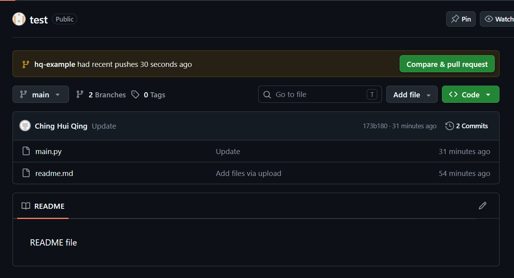

你也可以在 GitHub 仓库左上角的分支菜单中选择 `hq-example`。

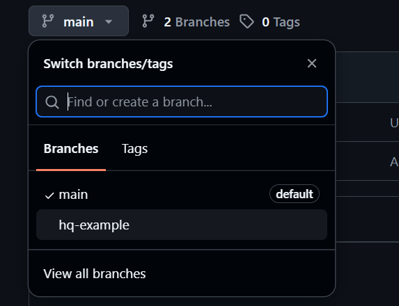

进入新分支后会看到 **This branch is 1 commit ahead of main**：代表该分支比主分支多了一个尚未合并的 Commit。

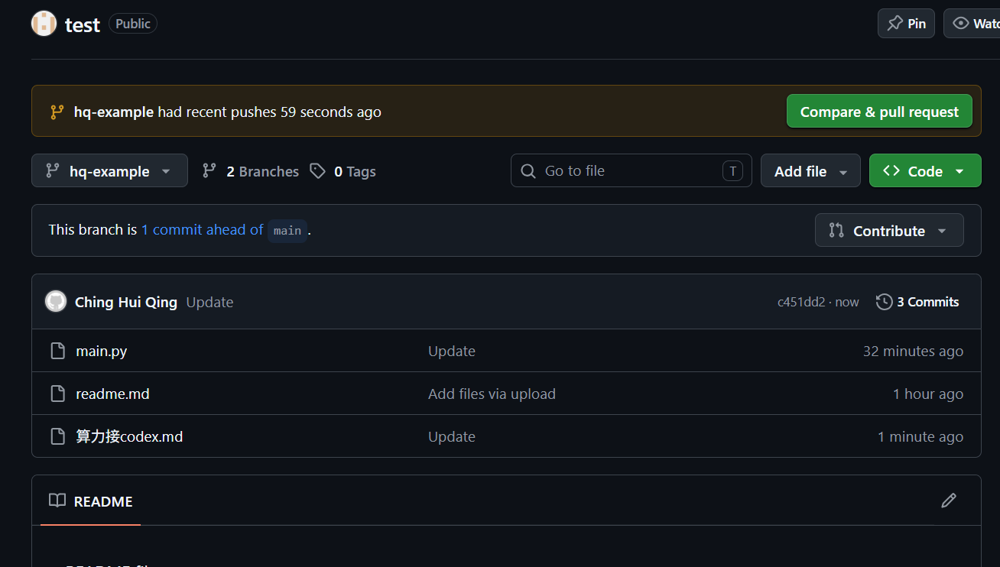

**合并步骤（这组截图尚未覆盖）：**

1. 点击 **Compare & pull request**。
2. 确认目标 `base: main`、来源 `compare: hq-example`。
3. 点击 **Create pull request**，请同学检查修改。
4. 没有问题后，点击 **Merge pull request → Confirm merge**（需要有合并权限）。

**Push Branch 不等于 Merge**：Push 只把分支上传，PR 合并后主分支才会包含该修改。

## 6. Pull：同步别人提交的代码

每次开始工作先更新本地的主分支：

```bash
git switch main
git pull
```

在 VS Code 中也可以点击 Source Control `... → Pull`。若有未提交的本地修改，先处理它们再拉取，避免覆盖或冲突。

**【待补截图】**：VS Code 的 Pull 菜单 / 拉取成功状态。

## 7. Conflict：如果两人修改同一行

Git 可能提示 **Merge Conflict**。在 VS Code 中打开冲突文件，选择保留当前版本、传入版本，或在 Merge Editor 手动整合，然后保存、Stage、Commit。

**【待补截图】**：VS Code Merge Editor 冲突界面。本次上传的 18 张截图中没有对应画面。

## 8. 重要命令速查

| 命令 | 作用 |
|---|---|
| `git status` | 查看当前状态 |
| `git clone URL` | 下载项目 |
| `git pull` | 获取并合并远程更改 |
| `git add .` | 暂存当前目录更改，执行前先检查 |
| `git commit -m "说明"` | 在本地建立提交 |
| `git push` | 上传提交 |
| `git branch` | 查看本地分支 |
| `git switch main` | 切换回主分支 |
| `git switch -c feature` | 新建并切换分支 |
| `git log --oneline` | 简要查看历史 |

## 9. 常见问题

**Q：Commit 了，为什么 GitHub 没更新？** 还需要 Push。

**Q：看到 `U`、`M`、`A` 是什么意思？** U = Untracked，M = Modified，A = Added（具体含义取决于所在状态区域）。

**Q：为什么是 Publish Branch，不是 Sync Changes？** 因为该新分支还没建立远程对应分支。

**Q：为什么 Push 被拒绝？** 可能没有权限，或远程已有你尚未同步的提交。先检查 `git status`、`git pull` 和提示，不要盲目强制推送。

**Q：API Key / 密码可以上传吗？** 不可以。把 `.env` 等敏感文件写进 `.gitignore`，但要注意 `.gitignore` 无法自动清除已提交到历史中的秘密。

**一句话：Clone 下载 → Pull 更新 → Branch 开发 → Stage 选择 → Commit 保存 → Push 上传 → PR 申请 → Merge 合并。**
