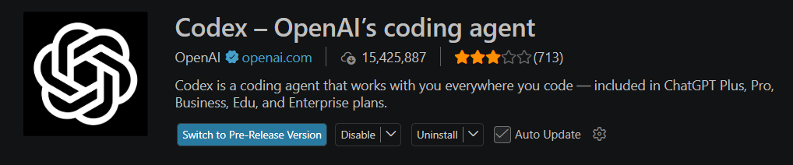

# VS Code Codex 接入 Paratera API 教程

适用环境：Windows + VS Code + OpenAI Codex 插件

**目标：** 使用 Paratera 提供的模型，同时保留原本的 ChatGPT Codex，随时切换。
## 0. vscode 内下载codex插件


## 1. 准备 API Key

1. 打开 [Paratera](https://ai.paratera.com/)。
2. 注册或登录账号。
3. 在控制台创建 API Key。
4. 找到需要使用的模型 ID，例如 `Qwen3.6-Flash`。

API 地址：

```text
https://llmapi.paratera.com/v1
```

## 2. 设置 Windows 环境变量

打开 PowerShell，执行：

```powershell
[Environment]::SetEnvironmentVariable(
    "PARATERA_API_KEY",
    "你的API密钥",
    "User"
)
```

验证是否成功：

```powershell
[Environment]::GetEnvironmentVariable(
    "PARATERA_API_KEY",
    "User"
) -ne $null
```

返回 `True` 表示保存成功。

**注意：** 设置完成后，需要完全关闭并重新打开 VS Code，让插件读取新的环境变量。不要将 API Key 直接写入配置文件或分享给别人。

## 3. 修改 Codex 配置

在 VS Code 的 Codex 插件设置中，选择 **Open config.toml**。

也可以直接打开：

```text
C:\Users\你的用户名\.codex\config.toml
```

在文件最顶部加入：

```toml
model_provider = "paratera"
model = "Qwen3.6-Flash"
model_reasoning_effort = "low"
```

然后在文件最末尾加入：

```toml
[model_providers.paratera]
name = "Paratera"
base_url = "https://llmapi.paratera.com/v1"
env_key = "PARATERA_API_KEY"
wire_api = "responses"
requires_openai_auth = false
```

**注意：**

- `model_provider` 和 `model` 必须写在所有 `[section]` 之前，不能放在文件末尾。
- `env_key` 填环境变量名称，不是 API Key。
- 不要重复定义 `model_provider`。
- 已有的 Plugins、MCP 等配置可以保留。
- 模型名称必须与 Paratera 提供的准确 ID 一致。
- 模型还必须支持 Codex 使用的 Responses API。

## 4. 在 VS Code 中使用

1. 保存 `config.toml`。
2. 按 `Ctrl + Shift + P`。
3. 执行 `Developer: Reload Window`。
4. 打开 Codex 插件。
5. **新建 Conversation（重要）。**
6. 发送消息测试。

**关键经验：切换模型后必须新建会话。旧会话可能继续使用之前的模型配置。**

Codex 的模型下拉菜单主要显示 OpenAI 官方模型，不一定会显示 Paratera 的 Qwen、GLM 等第三方模型。

即使选择 `Default`，也可能显示 `GPT-5.6 Sol` 等官方模型。不要只依据下拉菜单判断实际请求模型，应以成功请求或错误日志中的模型信息为准。

## 5. 如何切换回官方 Codex？

打开 `config.toml`，修改最顶部。

**使用 Paratera：**

```toml
model_provider = "paratera"
model = "Qwen3.6-Flash"
```

**使用官方 Codex：**

```toml
model_provider = "openai"
# model = "Qwen3.6-Flash"
```

不需要删除 `[model_providers.paratera]` 的配置，也不需要退出原本的 ChatGPT 账号。

每次切换后：

1. 保存配置。
2. 重新加载 VS Code。
3. **新建 Conversation。**

## 6. 常见错误

| 错误 | 原因与解决方式 |
|---|---|
| `401 Unauthorized`，请求发到 `api.openai.com` | Provider 没有正确生效；检查文件顶部的 `model_provider` |
| `Missing environment variable: PARATERA_API_KEY` | 环境变量没有被插件读取；检查设置并彻底重启 VS Code |
| `403 team not allowed to access model` | 请求的模型没有访问权限；检查实际模型 ID，尤其是否被旧会话覆盖 |
| `404 /v4/responses` | Paratera 对应模型的后端路径或 Responses API 可能不兼容 |
| 配置了 Qwen，却请求 GPT-5.5 | 可能沿用了旧会话模型；重新加载 VS Code 并新建 Conversation |
| 终端能用，插件不能用 | 先尝试新建 Conversation；必要时检查模型选择器是否覆盖配置 |

## 7. 终端备用方式

如果 VS Code Codex 插件无法正常调用第三方模型，可以在 VS Code Terminal 中执行：

```powershell
codex -c 'model_provider="paratera"' -m "Qwen3.6-Flash"
```

这样可以明确指定 Paratera 和模型，不依赖插件的模型下拉菜单。

## 最后总结

整个流程：

**创建 API Key → 设置环境变量 → 修改 config.toml → 重启 VS Code → 新建 Conversation → 使用 Paratera 模型。**

切回官方 Codex，只需要更改文件顶部的 `model_provider`，保存、重载并新建会话。

此方法已在实际操作中成功建立 Paratera 模型会话，但不同模型是否兼容 Codex 的 Responses API，需要分别验证。